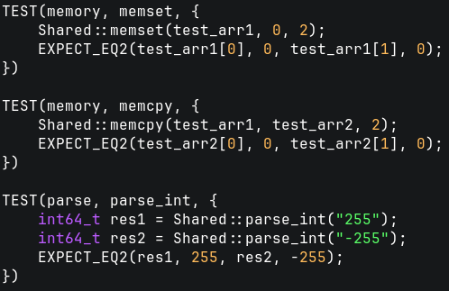
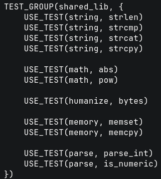
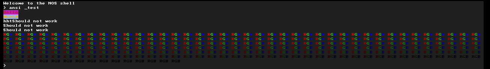

```
 /$$   /$$  /$$$$$$   /$$$$$$ 
| $$$ | $$ /$$__  $$ /$$__  $$
| $$$$| $$| $$  \ $$| $$  \__/
| $$ $$ $$| $$  | $$|  $$$$$$ 
| $$  $$$$| $$  | $$ \____  $$
| $$\  $$$| $$  | $$ /$$  \ $$
| $$ \  $$|  $$$$$$/|  $$$$$$/
|__/  \__/ \______/  \______/
```

# nos (nate operating system)
A small x86-64 operating system

## Features

### Boot
- Uses limine as bootloader
- GDT (Global Descriptor Table), IDT (Interupt Descriptor Table), PIT (Programmable Interupt Timer)
### Memory
- Bitmap allocator for managing physical pages
### Drivers
- Framebuffer
- PS2 Keyboard
- UART
### Library
- Small freestanding lib with things like strings, algo and tests

### Testing
- Testing framework for unit testing using macros
- Can test using methods like EXPECT_EQ or a function that returns a bool
- Supports grouping tests




### Terminal & Shell
- Small terminal emulator that supports ANSI color codes
- Kernel Shell:
  - Commands: test, palloc, ansi_test, time, rect
 


## Platforms
- I was able to make it boot on real hardware but I have some work to do before it is actually usable
- Work well in QEMU

## Status
Not under active development

## Prerequisites
g++, ld, nasm, objcopy, make, xorriso, qemu-system-x86_64

If on nixos just do
```
nix-shell
```

## Running

Normal build:
```
git clone https://github.com/NateDev5/nos
cd nos
make clean && make run
```
Debug build:
```
make clean && make dbg
```
Debug build (with gdb):
```
make clean && make gdb
```

## Goals for the future
- Scheduler
- Proper VMM & PMM
- Userspace
- Filesystem
- Running doom

## Resources Frequently Used
- [OSDev Wiki](https://wiki.osdev.org)
- Intel Software Developer Manual
